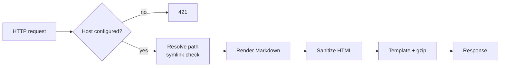

# How mdserve works

mdserve is a single process: an HTTP server, an in-memory site registry, and — when a
tunnel is enabled — a supervised `cloudflared` child process.

## Request flow

1. **Route.** The `Host` header selects a mount. There is no fallback: a host that is not
   configured gets `421 Misdirected Request`, even when only one mount exists.
2. **Resolve.** The URL path is cleaned, resolved with `EvalSymlinks`, and checked with
   `filepath.Rel` against the mount root. A symlink that points outside the root is treated
   as missing.
3. **Render.** Markdown is parsed, sanitized, and wrapped in the page template together with
   the tree and table of contents.
4. **Respond.** HTML is compressed when the client accepts gzip and the body is large enough
   to benefit.

## Mount registry

At startup each mount scans its root into a tree of directories and Markdown files. The scan
repeats every `server.refresh` (10 seconds by default), so new and deleted files appear within
that window.

File *content* is not cached by the scan: every request stats the file and reuses the parsed
document only when both mtime and size are unchanged. Editing a file is visible on the next
refresh of the page.

Two filters control what appears:

| Option | Effect |
| --- | --- |
| `server.exclude` | Paths are not scanned at all. Defaults: `.git`, `node_modules`, `.obsidian`, `.idea`, `.vscode`. |
| `server.hidden` | Paths stay in the index but are omitted from the tree, directory listings, and search. Direct links still work. |

`hidden` globs use Go's `path.Match` syntax. A pattern without `/` is matched against the file
or directory name at any depth, so `draft` hides every entry named `draft`; `*.wip.md` hides
those files everywhere.

## Rendering

- [goldmark](https://github.com/yuin/goldmark) with GFM, footnotes, and definition lists.
- Heading anchors are generated from the text, keeping CJK characters; duplicates get a
  `-2`, `-3` suffix.
- The table of contents is built from level-2 and level-3 headings.
- Tables are wrapped in `
` so wide tables scroll instead of breaking
  the layout.
- Fenced blocks tagged `mermaid` become placeholders; the diagram is rendered in the browser
  inside a sandboxed iframe that has no access to the page origin.
- Raw HTML passes through [bluemonday](https://github.com/microcosm-cc/bluemonday) with an
  allowlist: no scripts, no event handlers, no stylesheets, no iframes.

## Static assets

CSS, JavaScript, fonts, and Mermaid are embedded in the binary. Requests for `/-/vendor/*`
are served from a fixed whitelist — no directory listing, no path traversal.

Responses carry a content hash as `ETag` and `Cache-Control: public, max-age=31536000,
immutable`, because the URL changes when the binary changes (`?v=<hash>`). Assets are
pre-compressed in the background at startup; Mermaid is only fetched when a diagram is close
to the viewport.

## Sessions and share codes

A session token is `v1.<expiry>.<nonce>.<mac>`, where the MAC covers the host and a server
epoch. Cookies are `HttpOnly`, `SameSite=Lax`, and `Secure` over HTTPS.

Share codes use the same format with an `s1.` prefix and a server-side set of used nonces, so
each code works exactly once. Rotating the epoch file (`mdserve revoke`) invalidates every
session and every outstanding code; a running server notices within two seconds.

## Tunnel

With `tunnel.mode: named`, mdserve starts `cloudflared tunnel run` and passes the token through
the `TUNNEL_TOKEN` environment variable, so it never appears in `ps`. The child is restarted
with exponential backoff from one second up to thirty. mdserve never downloads the binary.

## Internal endpoints

Everything mdserve needs lives under `/-/`, so a `vendor/` or `search/` directory in your
documents is never shadowed.

| Path | Auth | Purpose |
| --- | --- | --- |
| `/-/health` | public | Returns `ok`; no version, no hostname. |
| `/-/vendor/*` | public | CSS, JavaScript, fonts, Mermaid. |
| `/-/mermaid` | public | Empty sandbox page that renders diagrams via `postMessage`. |
| `/-/login` | public | Login form. |
| `/-/logout` | session | POST only. |
| `/-/about` | session | Version, commit, build date, uptime. |
| `/search?q=` | session | Full-text search. |

## Limits

| Limit | Default |
| --- | --- |
| Document size | 4 MiB (`server.max_file_bytes`) |
| Login request body | 4 KiB |
| Login attempts | 8 per 10 minutes per IP, then a 10-minute lockout |
| Search | minimum 2 characters, 3 hits per document |
| Session | 8 hours absolute, 30 minutes idle |
